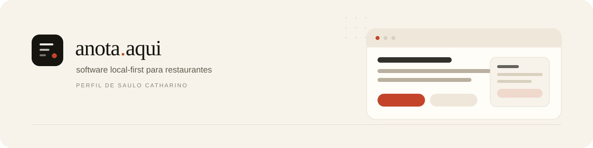

  <picture>
    <source media="(prefers-color-scheme: dark)" srcset="assets/banner-dark.svg">
    
  </picture>

<h1 align="center">anota.aqui</h1>

  
  
  
  
  

---

## Sobre

Sou contratado para resolver os grandes problemas de grandes empresas, sobrevivendo sob o jugo do capitalismo que trata tudo como mercadoria, como também nos conduz a ver tudo como comercializável. 

 Quase esquecemos que somos agentes de mudança e com potencia.

 Usando o pouco tempo e recurso que capitalismo não vampirizou, desenvolvi o **anota.aqui**, um console de operação para restaurantes que roda na máquina do restaurante. A ideia é simples: o pedido sai do WhatsApp, passa pela cozinha, vira entrega, fecha a conta e termina no pós-venda — sem planilha no meio e sem servidor central.

O projeto é **local-first**, **MIT** e **grátis e sempre será**. LLM e Mercado Pago são opcionais; o fluxo inteiro funciona com ou sem eles.

## Agora

- Construindo o console: pedidos, cozinha, entrega, pagamento, mapa e pós-venda.
- Afinando o atendimento no WhatsApp: leitura assistida, sugestões, envio opcional e supervisor de mensagens.
- Deixando o cardápio vivo: importar, ativar, desativar e manter o histórico.
- Testando o fluxo inteiro em um restaurante de verdade.

## Como eu penso

> Software de restaurante não precisa de servidor central, assinatura e nem de um robô falando com o cliente. Precisa resolver o turno.

- **Local-first.** Os dados ficam com quem produz o pedido.
- **Humano no comando.** O sistema sugere; a pessoa decide e confirma.
- **Sem dependência.** LLM e Mercado Pago são escolhas, não pré-requisitos.
- **Simples de rodar.** Um console, um banco local, um navegador.

## Stack

  
  
  
  
  
  
  

## Projetos

| Projeto | O que é | Estado |
| --- | --- | --- |
| **anota.aqui** | Console local-first para restaurantes: WhatsApp assistido, pedidos, cozinha, entrega, Pix e pós-venda. | em desenvolvimento |
| **anotaaqui.github.io** | Landing page do projeto, com a jornada e os recursos atuais. | público · [site](https://anotaaqui.github.io/) |
| **anotaaqui** | Este perfil. | público |

> O código da aplicação está privado por enquanto. Quando abrir, será sob MIT.

<strong>O que tem por dentro do anota.aqui</strong>

 

- **Console local:** Python + SQLite + interface web servida em `127.0.0.1`.
- **WhatsApp assistido:** leitura da conversa via WebDriver BiDi, preenchimento sem apertar Enter e envio automático opcional.
- **Pedido com estado:** rascunho, pagamento, cozinha, entrega, cancelamento e pós-venda.
- **Cardápio vivo:** importação do KiCardápio, ativação e desativação de pratos sem apagar o cadastro.
- **Entrega:** endereço, referência, acesso, taxa configurável, previsão e mapa com OpenStreetMap.
- **Pagamento:** Pix pelo Mercado Pago, Pix manual ou dinheiro/cartão na entrega.
- **Cozinha:** KDS, alerta de atraso, comanda térmica e baixa em um toque.
- **Pós-venda:** tentativa de retenção no cancelamento, encerramento e retomada na próxima saudação.
- **Supervisor:** mensagens não respondidas, fila travada e erro de envio são retomados automaticamente.
- **Sem servidor central:** o banco e os dados ficam na máquina do restaurante.

## Contato

- GitHub: [@anotaaqui](https://github.com/anotaaqui)
- E-mail: [zionfmbrasil@gmail.com](mailto:zionfmbrasil@gmail.com)

Feito com calma, café e SQLite.

